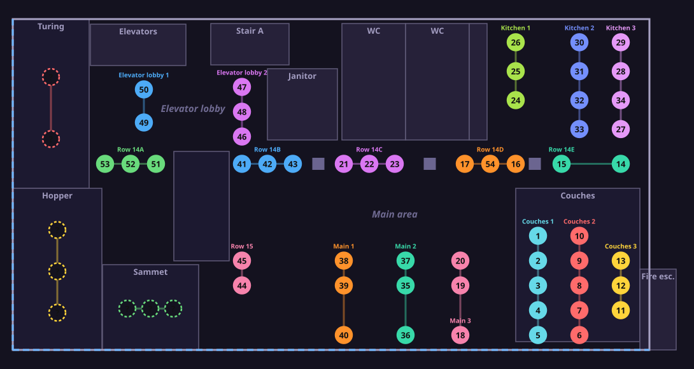

# Recurse light map

A 2D map of the arclight lights (1–55) at Recurse. It shows where each numbered light is and which row it belongs to.



## View

Open `dist/map.html` or `dist/map.svg`.

## Edit

```sh
npm start   # serves the map editor on your LAN; open the printed URL on a phone
```

Tap a light to change its number, drag it to move it, or use **Add bulb**, **Rows** and **Export**. Edits save in the browser. When you're done, export `mapping.json`, replace `data/mapping.json` with it, and regenerate:

```sh
npm run map   # data/mapping.json → dist/map.svg, dist/map.html
```

## Files

- `data/mapping.json`: light number → row and position. This is the source of truth.
- `src/floorplan.js`: the walls, rooms and pillars.
- `dist/`: the generated map.
