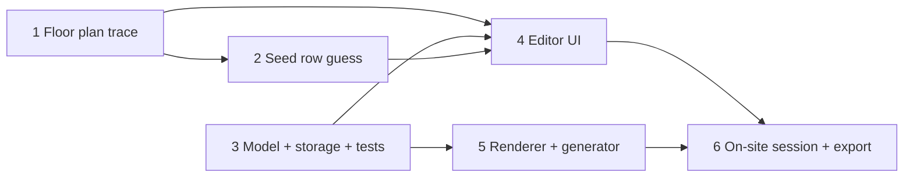

# Arclight Light Map: Implementation Plan

The app is a static, editable 2D map. It opens with a rough guess of the bulb rows. On site, Aaron assigns arclight numbers 1–55 to bulbs and fixes the layout, then exports the mapping and a clean map. There is no arclight connection.

## 1. Stack

- `index.html` + `app.css` + vanilla ES modules, rendered as SVG. No framework, no build step, no server: open it from any static host or `python3 -m http.server`.
- Tests use `node --test` on the pure modules.

```
index.html, app.css
src/
  floorplan.js   # traced outline, normalized coords (viewBox 0 0 1 0.4)
  seed.js        # initial rough guess: rows of bulbs (x, y), no numbers
  model.js       # pure: state + mutations + validation + export/import
  storage.js     # localStorage persistence
  render-map.js  # pure: state -> SVG string (shared by app + generator)
  app.js         # UI wiring: select, edit, drag, add, delete
gen-map.mjs      # mapping.json -> dist/map.svg + dist/light-map.html
test/*.test.mjs
```

## 2. Phases



Phases 1 and 3 can run in parallel. Phase 5 can run in parallel with Phase 4.

### Phase 1: Floor plan trace
Hand-trace the egress sign photo into `src/floorplan.js` using normalized coordinates (x 0–1, aspect ≈ 2.5). Include:
- the outer wall
- the left offices
- Stair A and the elevators
- the rooms along the top wall
- the kitchen
- the 3 columns
- the window wall
- the fire escape

Approximate geometry is fine.

### Phase 2: Seed rough row guess
Pull frames from `IMG_1457.MOV` (`ffmpeg` at about 1 fps). Estimate the ceiling runs (track and pipe lines) and the bulb count per run. Write `src/seed.js` as `rows: [{ id, bulbs: [{ id, x, y }] }]` with the bulbs unnumbered. Aim for a total of about 55, but don't force an exact count: on site, the user adds or deletes bulbs. Mark the seed as a guess in the UI. Leave a header comment in `seed.js` describing how the guess was made.

### Phase 3: Model, storage, tests
State:
```ts
type Bulb  = { id: string; x: number; y: number; num: number | null };
type Row   = { id: string; label?: string; bulbs: Bulb[] };  // array order = order in row
type State = { schemaVersion: 1; rows: Row[] };
```
Mutations, all pure and returning new state:
- `setNumber(bulbId, n | null)`. Rejects `n` outside 1–55. If `n` is already on another bulb, it **moves** the number (clearing the old bulb) and returns `{ state, displaced: oldBulbId }` so the UI can show it.
- `addBulb(rowId, x, y, index?)`, `deleteBulb`, `moveBulb(x, y)`, `moveBulbToRow(bulbId, rowId, index)`, `reorderInRow`
- `addRow`, `deleteRow` (blocked unless the row is empty, or confirmed by the user), `reorderRows`
- Derived: `unassigned(state) = {1..55} − assigned`

Export JSON (`mapping.json`):
```jsonc
{ "schemaVersion": 1, "kind": "recurse-arclight-light-map", "floorplan": "recurse-floor-v1",
  "rows": [ { "row": 1, "label": "…", "bulbs": [ { "num": 12, "x": 0.41, "y": 0.12 } ] } ],
  "unassigned": [5, 41] }
```
Import validates the file: it rejects bad versions, numbers outside 1–55, and duplicate numbers. Then it rebuilds the state.

Storage writes `localStorage["arclight-light-map:v1"]` synchronously on every mutation and loads it on boot. Seed state is used only when storage is empty. A **Reset to seed** button asks for confirmation first.

### Phase 4: Editor UI (phone-first)
- The map fills the screen and supports pinch-zoom and pan through the SVG `viewBox`.
- Tapping a bulb selects it and opens a bottom sheet with:
  - a big numeric input; Enter saves and closes
  - Delete bulb
  - a row picker
- **Add mode** toggle: tapping empty floor adds a bulb to the nearest row, or to the selected row if one is chosen.
- Dragging a selected bulb moves it.
- Bulbs:
  - Numbered bulbs are filled circles with the number inside.
  - Unnumbered bulbs are hollow and dashed.
  - Each row has its own color, with a faint polyline joining the row.
- Header shows "`N/55` assigned" and a collapsible list of unassigned numbers.
- Tapping an unassigned number pre-fills it into the next bulb you tap.
- Rows panel: add, delete, reorder, and rename rows.
- Export and Import buttons: download, copy JSON, file picker, and paste.
- Tap targets are at least 44 px. The layout must work at viewport widths from 360 to 430 px.

### Phase 5: Renderer + generator
`renderMap(state, opts) → SVG string` is pure and shared by the app preview and `gen-map.mjs`.

`gen-map.mjs data/mapping.json` writes:
- `dist/map.svg`: standalone, with styles inlined
- `dist/light-map.html`: self-contained, with the mapping and the renderer inlined, ready to port into arclight later

Labels must be at least about 11 px at a 360 px width. If they don't fit, the map pans horizontally in landscape rather than shrinking the labels.

### Phase 6: On-site session
1. Host the app: open the file on a laptop, or serve it on a LAN or any static host. No arclight access is needed.
2. Your friend lights bulbs one at a time in arclight and calls out each number. You tap the bulb and enter the number. Fix positions, add missing bulbs, and delete extras as you go.
3. When unassigned is empty, export to `data/mapping.json` and run `gen-map.mjs`.

## 3. ENSURE → validation

| ENSURE | Validation |
|---|---|
| Opens with floor plan and pre-placed bulbs in rows | Manual: a fresh load, with storage cleared, shows the seed rows. |
| Number labels a bulb; no duplicates | Unit tests: `setNumber` assigns the number; a duplicate moves the number and reports the displaced bulb; manual check that the UI indicates it. |
| Add, delete, drag, and move bulbs between rows; add and delete rows | Unit tests for each mutation; one manual pass on a phone. |
| Rejects numbers outside 1–55; unassigned = {1..55} − assigned | Unit tests: 0, 56, and 1.5 are rejected; the set invariant holds over a seeded random mutation loop. |
| Reload or phone lock keeps edits | Unit test: the storage round-trip is identical. Manual on iOS Safari: edit, then reload, lock, and kill the tab; nothing is lost. |
| Export → import gives an identical map | Unit test: `renderMap(import(export(s))) === renderMap(s)`; imports with tampered or duplicate numbers are rejected. |
| Generated map readable on a phone | Manual: `dist/light-map.html` at 360 and 430 px, portrait and landscape. A unit assist checks the minimum label size and that no circles overlap. |

## 4. Assumptions, risks, out of scope

**Assumptions**
- Numbers are read aloud from arclight by a person; the app never needs the arclight network.
- Tap-level position accuracy is enough to show rows and their order.

**Risks**

| Risk | Mitigation |
|---|---|
| Seed guess is far off | Editing is fast: add, delete, drag, and move between rows. The seed is only a starting point. |
| iOS evicts localStorage | Export at the end of each session; copy JSON as a backup. |
| Labels overlap in dense areas | Minimum label size, landscape pan, and an overlap check. |

**Out of scope**
- Any arclight API, flashing, or proxy
- Changes to arclight or Rose's UI
- Integrating into arclight.local
- Numbers 56–115
- Camera-sim and HAP video work
- Multi-device sync
